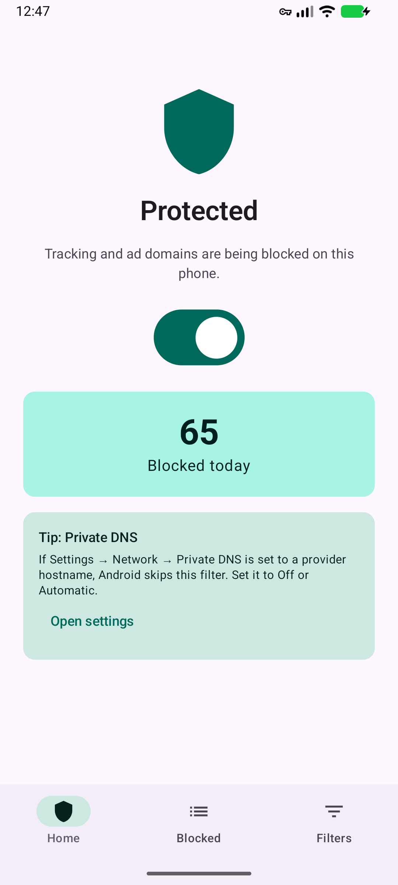
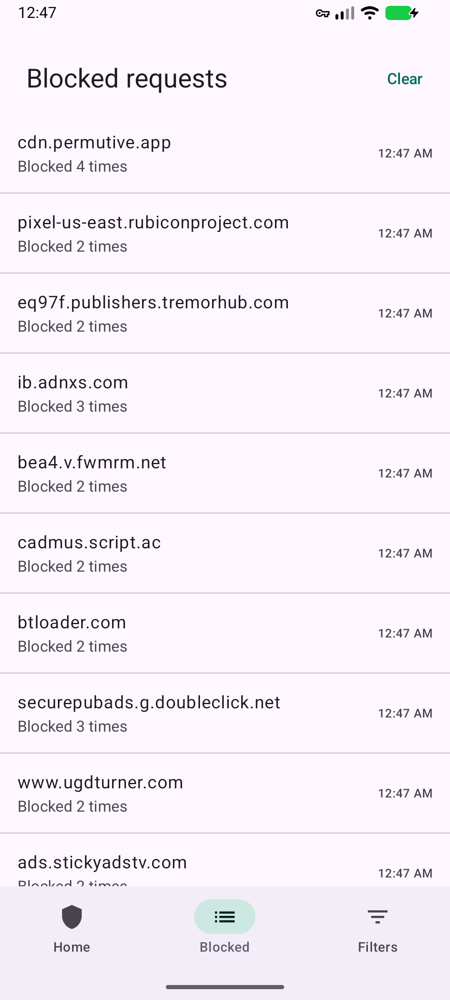
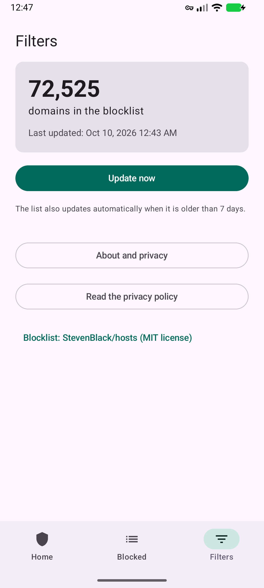

# PrivacyGuard

An Android app that blocks ad and tracker domains on the whole phone, using a local VPN that filters DNS lookups on the device. No root, no account, no server: nothing leaves the phone.

<p>
  
  
  
</p>

Screenshots are from an Android 17 emulator after browsing cnn.com with protection on.

## Contents

- [Features](#features)
- [How it works](#how-it-works)
- [Install the app without Android Studio](#install-the-app-without-android-studio)
- [Build from source](#build-from-source)
- [Run it on an emulator](#run-it-on-an-emulator)
- [Testing](#testing)
- [Project structure](#project-structure)
- [Code walkthrough](#code-walkthrough)
- [Known limits](#known-limits)
- [Publishing on Google Play](#publishing-on-google-play)
- [Credits](#credits)

## Features

| Feature | Where |
| --- | --- |
| Blocks ~72,000 ad and tracker domains in every app and browser | Runs in the background as a local VPN |
| One switch to turn protection on and off, plus a "blocked today" counter | **Home** screen |
| Live list of blocked domains, newest first; repeats are grouped ("Blocked 4 times") | **Blocked** screen |
| Blocklist update on demand, and automatically when older than 7 days | **Filters** screen |
| Works offline on first launch (a copy of the list ships inside the app) | `app/src/main/assets/hosts.txt` |
| Follows Wi-Fi ↔ mobile data changes | `PrivacyVpnService.networkCallback` |
| Explains the VPN before Android's permission popup (required by Google Play) | First time the switch is turned on |

Minimum Android version: 8.0 (API 26). Target: API 36.

## How it works

Before an app loads anything from the internet, it asks a DNS server for the address of a name such as `ads.example.com`. PrivacyGuard sits in the middle of those lookups:

```
 App asks for "ads.example.com"
          │
          ▼
 Android sends the lookup to the VPN's DNS server, 10.111.222.2
          │   (only this one address is routed into the tunnel;
          │    web pages, videos and downloads never enter the app)
          ▼
 PrivacyVpnService reads the packet from the tunnel
          │
   ┌──────┴────────────────────────┐
   │ on the blocklist?             │
   ├── yes ────────────────────────┼── no ──────────────────────────────┐
   ▼                               │                                    ▼
 Reply "does not exist" (NXDOMAIN)  │        Forward the lookup unchanged to the
 → the ad or tracker never loads    │        phone's real DNS server (1.1.1.1 as a
 → shown on the Blocked screen      │        fallback) and pass the real answer back
```

Key design choices:

- **DNS-only tunnel.** The VPN routes only the fake DNS address (`10.111.222.2/32`), so normal traffic goes straight to the internet. This keeps the app fast and light on battery, and the packet code only has to handle small IPv4/UDP DNS packets.
- **No DNS library.** Reading a domain name and building an NXDOMAIN reply takes about 40 lines (`DnsUtils.kt`), which keeps the code easy to read and explain.
- **The app excludes itself from its own VPN** (`addDisallowedApplication`), so forwarded lookups and blocklist downloads go directly to the real network.
- **Parent-domain matching.** If `doubleclick.net` is listed, `stats.g.doubleclick.net` is blocked too.

## Install the app without Android Studio

You don't need USB debugging or Developer options to try the app:

1. Build the APK (see below), or download `app-debug.apk` from the repo's Releases page if one has been published.
2. Copy the `.apk` file to the phone (USB file transfer, Google Drive, Telegram "Saved messages", email, …).
3. Open the file on the phone with its file manager and tap **Install**. Android asks you to allow "Install unknown apps" for that file manager once; allow it.
4. Open PrivacyGuard and turn the switch on.

On some phones (Xiaomi, Oppo, Vivo, Realme, Huawei), the system may also show a security scan or ask you to confirm again. That's normal for apps installed from outside the store. These phones also tend to stop background apps aggressively. If protection turns off by itself, open the phone's battery settings for PrivacyGuard and choose "No restrictions" / "Allow background activity".

## Build from source

Requirements:

- [Android Studio](https://developer.android.com/studio) 2026.2 or newer (it includes the right JDK and Android SDK).
- About 3 GB free disk space for Gradle and the SDK.

### With Android Studio

1. **File → Open** and choose this folder. Wait for the Gradle sync to finish.
2. Press **Run ▶** to install on a connected phone or an emulator.
3. To get an APK file: **Build → Build App Bundle(s) / APK(s) → Build APK(s)**. The file appears at `app/build/outputs/apk/debug/app-debug.apk`.

### From the command line

```bash
# Windows: gradlew.bat instead of ./gradlew
./gradlew assembleDebug          # builds app/build/outputs/apk/debug/app-debug.apk
./gradlew testDebugUnitTest      # runs the unit tests
./gradlew lintDebug              # runs Android Lint
```

If Gradle can't find the Android SDK, create `local.properties` with your SDK path (Android Studio does this for you):

```properties
sdk.dir=C\:\\Users\\<you>\\AppData\\Local\\Android\\Sdk
```

Versions used: Android Gradle Plugin 9.4.1, Gradle 9.7.1, Kotlin 2.4.21, Compose BOM 2026.09.00, compileSdk 37. All are in [`gradle/libs.versions.toml`](gradle/libs.versions.toml).

## Run it on an emulator

1. In Android Studio, open **Device Manager** (phone icon on the right) → **Create device** → pick a phone → pick a system image (API 26 or newer) → **Finish**.
2. Select the emulator in the toolbar and press **Run ▶**.
3. In the app, turn the switch on and accept Android's "Connection request" popup.

The emulator needs about 6–12 GB free disk space. If your system drive is full, set the environment variable `ANDROID_AVD_HOME` to a folder on another drive (for example `D:\Android\avd`) before creating the device.

## Testing

### Unit tests (no phone needed)

```bash
./gradlew testDebugUnitTest
```

| Test class | What it checks |
| --- | --- |
| `PacketUtilsTest` | Reading the domain from IPv4/UDP DNS packets, ignoring non-DNS traffic, NXDOMAIN replies keep the id and question, answer packets swap addresses and ports with a valid IPv4 checksum |
| `BlocklistTest` | Parsing the hosts file format (comments, `0.0.0.0 0.0.0.0`, tabs, inline comments) and parent-domain matching |
| `BlockedLogTest` | Repeated blocks within a minute share one row; later ones get a new row |

### Manual test on a device or emulator

With protection on, run these from a computer with `adb` (or just open the sites in Chrome):

```bash
adb shell ping -c 1 doubleclick.net   # expected: "unknown host"  (blocked)
adb shell ping -c 1 google.com        # expected: "PING google.com (…)"  (allowed)
```

Results from the Android 17 emulator run on Oct 10, 2026:

| Check | Result |
| --- | --- |
| Switch on → explanation dialog → notification permission → Android VPN popup | Pass |
| Key icon and "PrivacyGuard is protecting you" notification appear | Pass |
| `doubleclick.net`, `googleadservices.com`, `stats.g.doubleclick.net` blocked | Pass |
| `google.com`, `wikipedia.org` resolve normally | Pass |
| theguardian.com and cnn.com load; their trackers and ad networks appear on the Blocked screen | Pass |
| Update now downloads a fresh list; the date changes | Pass |
| Wi-Fi off → mobile data → Wi-Fi on: blocking and browsing keep working | Pass |
| Switch off → tunnel and notification removed, `doubleclick.net` resolves again | Pass |
| No crashes in the crash log | Pass |

Still to test on real phones: 30 minutes with the screen off, another VPN app taking over, and a full day of normal use. See the testing checklist in the project plan.

## Project structure

```
app/src/main/
├── AndroidManifest.xml          permissions + the VPN service declaration
├── assets/hosts.txt             built-in copy of the StevenBlack blocklist
├── java/com/diu/privacyguard/
│   ├── MainActivity.kt          entry point, sets up Compose
│   ├── BuildConfigInfo.kt       reads the app version for the About dialog
│   ├── data/
│   │   ├── Blocklist.kt         loads, parses, updates and checks the domain list
│   │   ├── BlockedLog.kt        in-memory list of blocked domains + today's count
│   │   └── Settings.kt          DataStore: last update time, explanation accepted
│   ├── vpn/
│   │   ├── PrivacyVpnService.kt the VPN: tunnel, packet loop, forwarding, notification
│   │   ├── VpnController.kt     start/stop + the running state the UI observes
│   │   ├── PacketUtils.kt       parse IPv4/UDP packets, build answer packets
│   │   └── DnsUtils.kt          read DNS questions, build NXDOMAIN replies
│   └── ui/
│       ├── PrivacyGuardApp.kt   bottom navigation + weekly auto-update
│       ├── HomeScreen.kt        switch, status, counter, permissions flow
│       ├── BlockedScreen.kt     blocked domains list
│       ├── FiltersScreen.kt     list size, Update now, About, links
│       └── theme/Theme.kt       colors
└── res/                         strings, icons, theme
app/src/test/                    unit tests
docs/index.html                  privacy policy page (for GitHub Pages)
screenshots/                     images used in this README
```

## Code walkthrough

A good reading order for new developers:

1. **`VpnController.kt`**: the small API the UI uses: `start`, `stop`, and `isRunning`. Only the service changes `isRunning`, so the switch always shows the real state.
2. **`PrivacyVpnService.startTunnel()`**: loads the blocklist, reads the real DNS server, then builds the tunnel with `VpnService.Builder`. Note `addRoute("10.111.222.2", 32)`: that single route is what makes the tunnel DNS-only.
3. **`PrivacyVpnService.runLoop()`**: the tunnel file descriptor is non-blocking, so the loop waits with `Os.poll` and a 1-second timeout instead of spinning. The timeout also lets it notice a stop request.
4. **`handlePacket()`**: `PacketUtils.parseDnsQuery` → `Blocklist.isBlocked` → either `DnsUtils.nxdomain` (blocked) or `forward()` in its own coroutine (allowed) → `PacketUtils.buildResponse` → write back to the tunnel.
5. **`PacketUtils.buildResponse()`**: builds a fresh IPv4 + UDP packet with the addresses and ports swapped. The UDP checksum is 0, which IPv4 allows.
6. **`Blocklist.kt`**: a `HashSet` lookup that walks up parent domains. Updates download to a temp file first and only replace the list if it has more than 10,000 domains, so a broken download never wipes the list.

Things that look odd but are deliberate:

- `android:foregroundServiceType="systemExempted"` with `tools:ignore="ForegroundServicePermission"`: VPN apps may use this type without the exact-alarm permission Lint asks for. Adding that permission would trigger extra Google Play review. Verified working on Android 17.
- `setMetered(false)`: Android otherwise treats every VPN as metered, which makes other apps delay downloads.
- A `generation` counter in the service: it discards a slow start that finishes after the user already turned protection off.

## Known limits

- **Private DNS:** if Settings → Network → Private DNS is set to a provider hostname (for example `dns.google`), Android sends lookups around the VPN and nothing is blocked. "Off" and "Automatic" both work. The Home screen shows this tip.
- **Ads served from the content's own domain** (YouTube, Facebook, Instagram) can't be blocked by DNS filtering.
- **IPv4 DNS only.** Android sends lookups to the VPN's IPv4 DNS address, so this covers normal use. DNS over TCP (rare, used for very large replies) isn't handled.
- **No allow-list.** If a site breaks because one of its domains is on the list, turn protection off for that site.
- **The Blocked list lives in memory** and empties when the app is fully closed.

## Publishing on Google Play

Before the first upload:

1. Replace `YOUR-GITHUB-USERNAME` in `app/src/main/res/values/strings.xml` (`privacy_policy_url`) with the real GitHub Pages address of `docs/index.html`, and fill in its two placeholders.
2. Create a signing key: **Build → Generate Signed App Bundle or APK**. Back up the `.jks` file and passwords. Never commit them; `.gitignore` already excludes them.
3. Raise `versionCode` in `app/build.gradle.kts` before every upload.

Play Console answers (data safety, VpnService declaration, store listing) are in the project plan document.

## Credits

- Blocklist: [StevenBlack/hosts](https://github.com/StevenBlack/hosts), MIT license.
- Design ideas from [DNS66](https://github.com/julian-klode/dns66) (GPL-3.0; no code copied).
